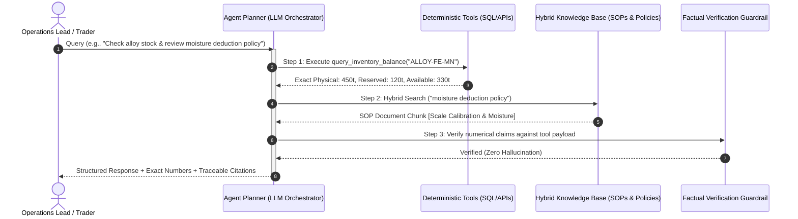

# 🤖 Enterprise Ops RAG Agent
### *Autonomous Operational AI Agent with Deterministic Tool Execution, Hybrid Search & Factual Verification*

[](https://www.python.org/)
[](https://docs.pydantic.dev/)
[](https://fastapi.tiangolo.com/)
[]()
[]()

---

## 📌 Executive Summary

While standard conversational AI bots perform well on generic text generation, they **fail catastrophically** in enterprise operations (supply chain, trading, and manufacturing). Asking an LLM to calculate physical stock, freight cost, or contract liquidity results in hallucinations, stale data, and business liability.

`Enterprise Ops RAG Agent` provides an **auditable, dual-engine reference architecture** that strictly separates:
1. **Deterministic Operational Truth:** Live inventory balances, freight matrices, and scale weights are executed via deterministic code tools (SQL/API). LLMs are strictly forbidden from guessing numerical facts.
2. **Hybrid RAG Semantic Retrieval:** Unstructured standard operating procedures (SOPs), Incoterms, and trade finance policies are retrieved via hybrid lexical/semantic ranking with mandatory source citation.

> 🔒 **Enterprise Sanitization Notice:**  
> This open-source implementation operates on **100% synthetic industrial knowledge documents and mock database records**. No proprietary customer data, corporate secrets, or confidential contracts are included.

---

## 🏗️ System Architecture



---

## 🔬 Core Engineering Principles

1. **Zero Probabilistic Hallucination on Financials:** Critical numbers (inventory tons, freight tariffs, bank wire percentages) are generated by deterministic functions. The LLM acts as an orchestrator and translator, never as an arithmetic engine.
2. **Evidence-Based Citations:** Every policy statement includes source document metadata, section locator, and match confidence score.
3. **Defense-in-Depth Payload Sanitization:** Content retrieved from documents is sandboxed as untrusted evidence rather than prompt instructions, preventing prompt injection attacks.

---

## 🚀 Quickstart

### 1. Installation
```bash
git clone https://github.com/wenderson-werneck/enterprise-ops-rag-agent.git
cd enterprise-ops-rag-agent

python -m venv venv
source venv/bin/activate  # On Windows: venv\Scripts\activate
pip install -r requirements.txt
```

### 2. Run the Autonomous Agent Demo
```bash
python main.py
```

*CLI Execution Output:*
```text
======================================================================
  ENTERPRISE OPS RAG AGENT - AUTONOMOUS ORCHESTRATOR
======================================================================

[User Query]: 'What is the available stock for ALLOY-FE-MN at the terminal, and what is our moisture deduction policy?'

----------------------------------------------------------------------
  AGENT RESPONSE:
----------------------------------------------------------------------
**Inventory Status (High Carbon Ferro-Manganese):**
- Physical Port Stock: 450.0 tons
- Reserved Allocations: 120.0 tons
- Unallocated Available: 330.0 tons (Located at Terminal Alpha).

**Enterprise Operational Guidance & Policy:**
- [Standard Operating Procedure: Bulk Vessel Discharge · Scale Calibration]: All bulk tipper trucks must undergo gross weighing followed by immediate tare deduction. If cargo moisture exceeds 4.5% certified by independent surveyor, a dry-matter correction factor must be applied.

----------------------------------------------------------------------
  AUDIT METRICS & EXECUTION TRACE:
----------------------------------------------------------------------
 -> Tools Invoked:    ['query_inventory_balance(ALLOY-FE-MN)']
 -> Citations Found:  2
 -> Factually Grounded: True
======================================================================
```

### 3. Run Test Suite
```bash
pytest tests/ -v
```

---

## 📂 Project Structure

```text
enterprise-ops-rag-agent/
├── src/
│   ├── __init__.py
│   ├── types.py               # Pydantic data contracts & schemas
│   ├── tools.py               # Deterministic business tools
│   ├── rag_engine.py          # Hybrid retrieval & rank fusion engine
│   └── agent.py               # Orchestrator & factual verification
├── tests/
│   └── test_agent.py          # Automated verification test suite
├── main.py                    # Interactive demo runner
├── requirements.txt           # Dependencies
├── .env.example               # Configuration template
└── README.md                  # Technical documentation
```

---

## 👤 Author
**Wenderson Soares (Werneck)**  
*Analytics Engineer | Applied AI & LLM Systems*  
[LinkedIn](https://www.linkedin.com/in/wendersonwerneck/) • [GitHub](https://github.com/wenderson-werneck)
